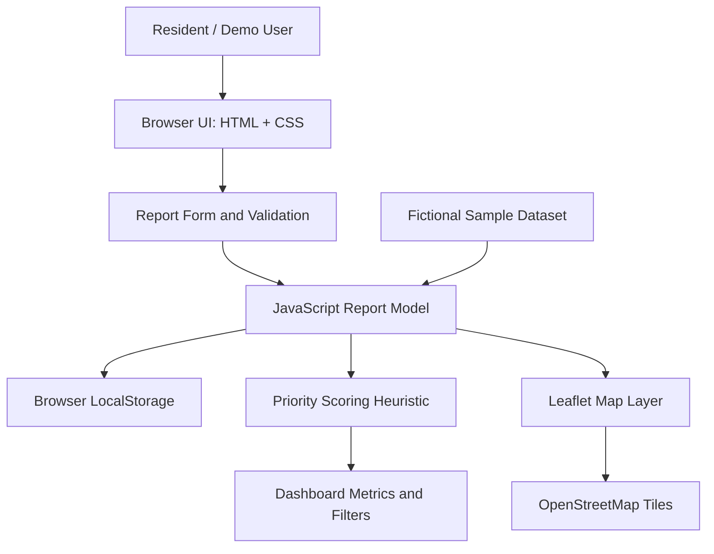

# CivicPulse Technical Design Document

## 1. Purpose
CivicPulse demonstrates a community-based way to record waterlogging, blocked drains, and unsafe-road observations, then organise reports into a map and a prioritised list.

## 2. Scope
### Included in this prototype
- Browser-based report form and required-field validation.
- Category, priority, and neighbourhood filters.
- Dashboard metrics.
- Interactive map markers when coordinates are present.
- Transparent priority scoring.
- Browser LocalStorage persistence.
- Fictional sample data.

### Not included
- Backend or shared database.
- User accounts, verification, moderation, or authority workflows.
- Official municipal integration.
- Production-grade privacy/security controls.
- Validated flood-risk prediction or AI-based classification.

## 3. Architecture diagram

The Mermaid diagram can be rendered in compatible Markdown viewers or copied into the competition's architecture slide.

## 4. Main components
- **User interface:** `index.html` contains the page structure, styles, form, dashboard, filters, and language toggle.
- **Report model:** JavaScript objects represent reports with an ID, category, location, description, severity, optional coordinates, timestamp, and source label.
- **Local persistence:** browser LocalStorage keeps demo reports on the same browser/device.
- **Priority module:** computes a simple score from severity, recency, and repeated reports at the same named location.
- **Dashboard:** calculates total reports, high-priority count, repeated-location hotspot count, and filtered report list.
- **Map:** Leaflet renders markers over OpenStreetMap tiles; only records with numeric coordinates are plotted.
- **Sample dataset:** fictional reports around the Tambaram/Chromepet/Pallavaram area.

## 5. Data flow
1. User enters a category, neighbourhood, severity, description, and optionally both latitude and longitude.
2. The form validates required fields and checks that coordinates are supplied as a pair.
3. A report object is created and inserted into the in-memory report list.
4. The list is saved to LocalStorage.
5. Dashboard metrics, score, priority labels, filters, and map markers are refreshed.
6. The user can reset the demo data to the original fictional sample records.

## 6. Data model
| Field | Type | Required | Description |
|---|---|---:|---|
| id | string | Yes | Demo report identifier |
| category | string | Yes | Waterlogging, Blocked drain, or Unsafe road |
| location | string | Yes | Neighbourhood or landmark text |
| description | string | Yes | Short observation |
| severity | integer 1–3 | Yes | 1 = low, 2 = medium, 3 = high |
| lat | number or null | No | Approximate latitude |
| lng | number or null | No | Approximate longitude |
| createdAt | integer | Yes | Timestamp in milliseconds |
| source | string | Yes | `sample` or `user` |

## 7. Priority scoring
The demonstration score is:

`score = severity × 20 + recency + repeat-location bonus`

- Severity contribution: 20, 40, or 60 points.
- Recency contribution: starts at 20 and decreases linearly to zero over 20 hours.
- Repeat-location bonus: 10 points per additional report with the same case-insensitive location name, capped at 20.
- Priority labels: High ≥ 75; Medium ≥ 50; Low < 50.

This is an illustrative heuristic only. It is not an official assessment, does not predict flooding, and must not be used for real-world emergency decisions.

## 8. External dependencies
- Leaflet 1.9.4 from a public CDN.
- OpenStreetMap map tiles and attribution.
- Browser LocalStorage and Geolocation APIs (geolocation only after user action and browser permission).

No API keys or environment variables are required for the current static demo.

## 9. Security, privacy, and ethical considerations
- Do not collect names, phone numbers, or unnecessary personal data.
- User reports remain in the local browser; they are not transmitted.
- Optional images are not uploaded; only the selected filename is recorded.
- Sample data is fictional and locations are approximate.
- A real deployment would need consent, retention/deletion controls, authentication, server-side validation, moderation, abuse prevention, accessibility testing, and a formal incident-escalation process.

## 10. Testing
See `TEST_CASES.md` for manual test cases and `sample_data.json` / `sample_data.csv` for fictional test records.

## 11. Future improvements
- Backend API and database with authentication and role-based access.
- Report status tracking and authorised verification workflow.
- Duplicate-report detection and moderated photo uploads.
- Validated prioritisation designed with residents and civic experts.
- Automated unit and integration tests.
- Accessibility and Tamil translation review.
